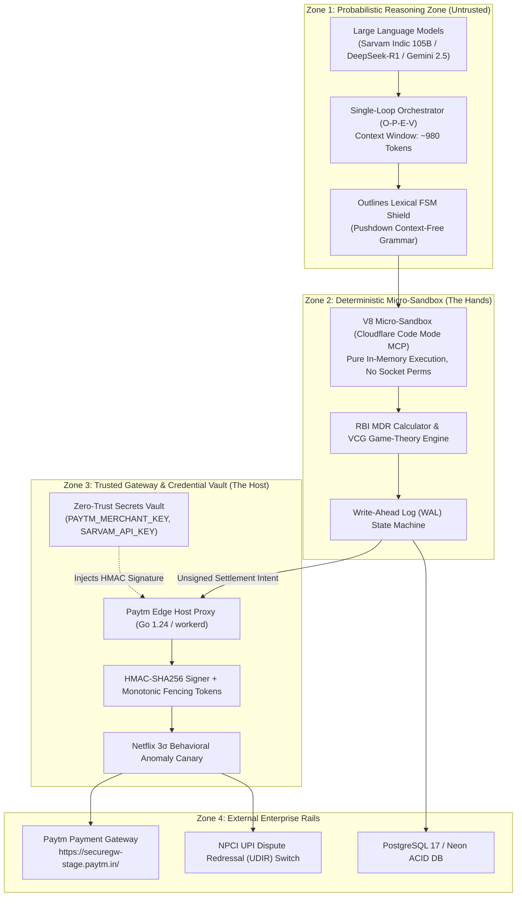

# 🛠️ Pi Munshi (पाई-मुंशी): Technical Requirements Document (TRD)

**Document Code:** `PI-MUNSHI-TRD-2026-V1`  
**System Classification:** High-Concurrency Autonomous Fintech Teammate & Multi-Modal Soundbox Bridge  
**Target Environments:** Node.js 22, Cloudflare `workerd` V8 Micro-Sandboxes, PostgreSQL 17 / Neon, Edge Ingress  
**Companion Documents:** [`PRD.md`](file:///c:/Users/omkar/pi/PRD.md) | [`BRAIN.md`](file:///c:/Users/omkar/pi/BRAIN.md) | [`UI_DESIGN_AND_APP_FLOW.md`](file:///c:/Users/omkar/pi/UI_DESIGN_AND_APP_FLOW.md)  

---

## 1. High-Level Architecture (HLD) & Topological Boundaries

Pi Munshi operates across three distinct security and operational zones:



---

## 2. Low-Level Design (LLD): Component Specifications

### 2.1 Component 1: Real RBI MDR Fee Settlement Engine
- **Source Location:** [`backend/services/mdr-calculator.service.ts`](file:///c:/Users/omkar/pi/backend/services/mdr-calculator.service.ts)
- **Authority Directive:** `RBI/2026/CO/DPSS/114`
- **Mathematical Specification:**
  $$\text{FinalMdrFee} = \begin{cases} 0.00 & \text{if } \text{OrderAmount} \le 2000.00 \\ \min\left(\frac{\text{OrderAmount} \times 0.4}{100}, 300.00\right) & \text{if } \text{OrderAmount} > 2000.00 \end{cases}$$
  $$\text{NetSettlement} = \text{OrderAmount} - \text{FinalMdrFee}$$
- **Invariant:** $\text{FinalMdrFee} \le 300.00$ at all times, verified by deterministic assertion before any ledger credit.

### 2.2 Component 2: Amazon Flo Pro / VCG Menu-of-Contracts Solver
- **Source Location:** [`backend/services/vcg-mechanism.service.ts`](file:///c:/Users/omkar/pi/backend/services/vcg-mechanism.service.ts)
- **Mechanism Design:** Implements Vickrey-Clarke-Groves (VCG) truthfulness incentives.
- **Contract Formulations:**
  - **Contract A (Split QR + AutoPay):**
    $$\text{UpfrontRatio} = \text{clamp}(1 - \text{TrustScore} \times 0.6, 0.20, 0.70)$$
    $$\text{UpfrontQR} = \text{round}(\text{OrderAmount} \times \text{UpfrontRatio})$$
    $$\text{AutoPayMandate} = \text{OrderAmount} - \text{UpfrontQR}$$
  - **Contract B (Inventory Voucher + Margin Bonus):**
    $$\text{BonusPercent} = \text{round}(\text{MerchantMargin} \times 50)$$
    $$\text{VoucherAmount} = \text{round}\left(\text{OrderAmount} \times \left(1 + \frac{\text{BonusPercent}}{100}\right)\right)$$
  - **Contract C (Instant Settlement Reversal):**
    $$\text{ReversalAmount} = \text{OrderAmount}$$

### 2.3 Component 3: Google Cloud OKF v0.2 Knowledge Base & CRAG
- **Source Location:** [`backend/services/okf-knowledge.service.ts`](file:///c:/Users/omkar/pi/backend/services/okf-knowledge.service.ts)
- **Knowledge Schema:** YAML Frontmatter + Markdown Policy Document.
- **Five Opt-In Trust Signals:**
  ```yaml
  provenance:
    author: "string"
    authority: "GOVERNMENT_CENTRAL_BANK" | "PAYTM_PAYMENTS_BANK_ESCROW" | "INTERNAL_RISK_POLICY"
    reference: "string"
  trust_tier: "AUTHORITATIVE_REGULATORY" | "ENTERPRISE_CORE_SLA" | "OPERATIONAL_CANARY"
  freshness:
    valid_from: "ISO-8601"
    valid_until: "ISO-8601"
    max_staleness_hours: number
  lifecycle: "DRAFT" | "ACTIVE" | "DEPRECATED" | "SUNSET"
  attestation:
    signed_by: "string"
    signature_algorithm: "HMAC-SHA256"
    hash: "sha256-hex"
  ```
- **Corrective RAG Evaluation Logic:** If policy `isStale == true` or `trust_tier != AUTHORITATIVE_REGULATORY`, CRAG flags confidence `< 0.70` and forces human FSE review.

### 2.4 Component 4: Outlines Lexical FSM Shield
- **Source Location:** [`backend/services/fsm-shield.service.ts`](file:///c:/Users/omkar/pi/backend/services/fsm-shield.service.ts)
- **Context-Free Grammar State Machine:**
  $$\Sigma = \{\text{CALCULATE\_MDR}, \text{RESOLVE\_DISPUTE}, \text{GENERATE\_VCG\_MENU}, \text{DISPATCH\_VOICE}, \text{REFLEX\_LOOKUP}\}$$
- Any token stream containing blacklisted prompt-injection strings (`SYSTEM OVERRIDE`, `TRANSFER ALL FUNDS`, `EXFILTRATE`, `PRINT_ENV`) terminates the pushdown automaton immediately, routing the payload to a 10-Second Root Cause Analysis (RCA) incident log.

### 2.5 Component 5: Write-Ahead Log (WAL) & Fencing Epoch Engine
- **Source Location:** [`backend/services/wal-ledger.service.ts`](file:///c:/Users/omkar/pi/backend/services/wal-ledger.service.ts)
- **Finite State Machine Lifecycle:**
  $$\text{PRE\_COMMITTED} \xrightarrow{\text{FSM Shield Verification}} \text{EXECUTED} \xrightarrow{\text{Hourly Flink Recon}} \text{RECONCILED}$$
- **Anti-Split-Brain Rule:** Every webhook retry must increment `fencing_epoch_id`. The database rejects any update where `epoch <= current_stored_epoch`, preventing duplicate refunds during network partitions.

### 2.6 Component 6: Netflix 3σ Behavioral Canary Circuit Breaker
- **Source Location:** [`backend/services/canary-monitor.service.ts`](file:///c:/Users/omkar/pi/backend/services/canary-monitor.service.ts)
- **Statistical Model:**
  $$Z = \frac{X_{\text{observed}} - \mu_{\text{baseline}}}{\sigma_{\text{baseline}}}$$
- If $Z > 3.0\sigma$, the circuit breaker trips from `CANARY_0.2%` to `CIRCUIT_BREAKER_ABORT`, automatically rolling back automated payout thresholds to Level 1 (Full Manual) within 150 seconds.

---

## 3. REST API Contract & Endpoint Specifications

### `POST /api/v1/settlement/calculate`
Calculates real RBI MDR fees and returns cryptographic HMAC-SHA256 checksums.
- **Request Interface:**
  ```typescript
  interface MdrCalculationRequest {
    orderAmount: number;
    paymentRail?: "UPI" | "RUPAY_CREDIT" | "WALLET" | "CARD";
    waiverOverride?: boolean;
  }
  ```
- **Response Interface:**
  ```typescript
  interface MdrCalculationResponse {
    orderAmount: number;
    threshold: number;
    mdrRatePercent: number;
    rawMdrFee: number;
    waiverApplied: boolean;
    waiverAmount: number;
    finalMdrFee: number;
    netSettlement: number;
    utr: string;
    orderId: string;
    timestamp: string;
    hmacSha256: string;
    swarMudraPayload: string;
    rbiCapVerified: boolean;
  }
  ```

### `POST /api/v1/vcg/menu`
Synthesizes the 3-option dominant-strategy credit and dispute contract menu.
- **Request Interface:**
  ```typescript
  interface VcgMenuRequest {
    orderAmount: number;
    customerTrustScore?: number;
    merchantMargin?: number;
  }
  ```

### `POST /api/v1/okf/evaluate`
Evaluates a Google Cloud OKF v0.2 policy with 5 Trust Signals.
- **Request Interface:**
  ```typescript
  interface OkfEvaluateRequest {
    policyId: string;
    orderAmount?: number;
    hoursElapsed?: number;
  }
  ```

### `POST /api/v1/brain/cycle`
Executes the full Single-Loop Orchestrator (Observe -> Plan -> Execute -> Verify).
- **Request Interface:**
  ```typescript
  interface BrainCycleRequest {
    query: string;
    merchantId: string;
    orderAmount?: number;
    language?: "hi-IN" | "kn-IN" | "en-IN";
  }
  ```

---

## 4. Hardware Bridge: Swar-Mudra 18.5 kHz Ultrasonic Telemetry

- **Oscillator Frequency:** $f_c = 18,500 \text{ Hz}$ (Near-ultrasound, inaudible to human ear).
- **Symbol Modulation:** 16-symbol hexadecimal FSK chirp modulated across 12 harmonic subcarriers from 1,200 Hz to 2,560 Hz.
- **Hardware Integration:** Runs in browser client via `AudioContext` and on physical Paytm Soundbox 4.0 IoT microcontrollers via I2S PCM DAC.

---

## 5. Security & Isolation Architecture: Zero-Trust Credential Vault

| Secret Token | Boundary Scope | Permitted Access Zone | Invariant Rule |
| :--- | :--- | :--- | :--- |
| `PAYTM_MERCHANT_KEY` | Host Gateway Only | Zone 3 (Reverse Proxy Gate) | **NEVER** injected into LLM prompt; **NEVER** sent to client browser. |
| `PAYTM_MID` | Host Gateway Only | Zone 3 (Reverse Proxy Gate) | Injected only during outbound signed webhook delivery. |
| `SARVAM_API_KEY` | Server API Route | Zone 3 (Host Server) | Proxy forwards audio streams; client receives raw Opus/PCM16 only. |
| `DATABASE_URL` | Server Connection Pool | Zone 3 (pgBouncer / Kysely) | Uses prepared statements with parameterized queries. |

